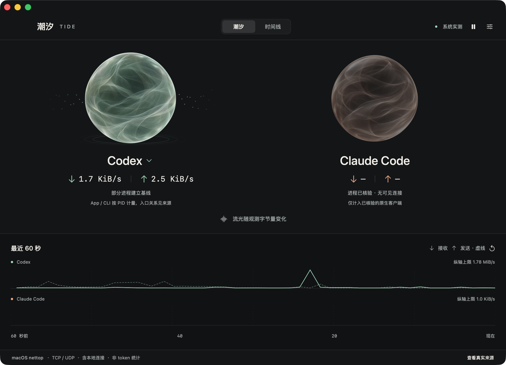

# 潮汐 · AI Tide

A native macOS visualizer for **observed network bytes of verified AI client processes**. Jade and copper sculptures respond to measured traffic, with a one-minute history, a menu-bar view and a source inspector.

**[Website & installation](https://harnessloom.com/ai-tide/)** · **[Downloads](https://github.com/jokeuncle/ai-tide/releases)** · MIT



## Install

Download the Universal DMG from Releases, drag **AI Tide.app** into Applications, and launch it. macOS 14+; Apple Silicon and Intel slices are included. Runtime testing was performed on Apple Silicon/macOS 26; Intel hardware remains untested.

This preview is **ad-hoc signed, not Apple-notarized**. Browser-downloaded builds may require per-application approval in **System Settings → Privacy & Security → Open Anyway**, after checking the download origin and SHA-256. Never disable Gatekeeper globally. See [installation notes](docs/INSTALL.txt).

**No runtime dependencies to install:** uses Apple's `/usr/bin/nettop`, process metadata and Security.framework. No Python, Node, Swift toolchain, root privileges, proxy, TLS interception, system extension or network setting changes are needed by the app. The app itself sends no network requests and records no payloads, prompts or credentials.

## What is identified

- Native **Claude Code**: Apple-anchored Anthropic signature and the exact `com.anthropic.claude-code` identifier, including version-number executable names.
- **Codex App / CLI / TUI**: approved OpenAI signatures for GUI/network helper/CLI processes, each counted once by PID. Current verified App ancestry is shown where available; otherwise the launch entry remains explicitly unknown.
- Native **ChatGPT** signing identifiers are included in policy, separately from Codex. The installed OpenAI app in this validation used Codex identifiers; an independent ChatGPT chat build has **not** been end-to-end tested.

Names, installation paths and destination domains are not sufficient evidence. The collector enumerates running same-user code, verifies signatures, pairs each PID with birth time and executable path, and rechecks identity around sampling. No developer-machine home path, pinned PID, custom API endpoint or installation location is required.

## Accuracy boundaries

Reads per-process TCP/UDP byte counters, including local connections, background traffic and the client-to-proxy leg. Byte rates use monotonic elapsed time. First samples, missing rows, errors and counter resets produce unavailable/baseline states rather than fabricated rates. Short-lived processes and connections ending between snapshots can be missed; observed positive deltas are not a complete lifetime, billing or audit ledger.

Traffic does **not** reveal tokens, prices, prompt/response content, thinking state, request count or session boundaries. Browser tabs, remote SSH tasks, spawned tools, external proxy legs and unsupported legacy runtime signatures are not guessed into an AI client.

## Build

Requires macOS with **Xcode Command Line Tools containing Swift 6+** (`xcode-select --install`). No third-party Swift packages.

```sh
swift run tide-tests
scripts/build-app.sh --universal
scripts/build-dmg.sh
open 'dist/AI Tide.app'
```

`--native` builds only the current architecture for development. To publish a Developer ID build, set `TIDE_SIGN_IDENTITY` to your own valid signing identity, build, then notarize and staple with your Apple Developer account before distribution. Credentials are never stored in this repository. `scripts/build-app.sh` validates both art resources inside the actual packaged application.

## Verification

```sh
swift run tide-probe --seconds 15
# Controlled local transfer, with no AI request:
python3 scripts/verify-transfer.py
# Optional: one tiny real request using each installed CLI's existing authentication.
# These requests consume the user's provider quota; no credentials are copied.
python3 scripts/verify-live.py
```

The standalone Swift test runner is used because a Command Line Tools-only install may omit XCTest. It covers CSV corruption and reordered columns, signature spoofing, PID reuse, executable changes, initial baselines, counter resets and gaps. Real collected paths stay in gitignored JSONL. The shareable [verification summary](docs/VERIFICATION.md) separates request success, signed-process observation, traffic observation, UI and portability checks.

Original bitmap materials were generated with imagegen; UI, animation and measurements are native SwiftUI/Canvas. The animations do not replay a screenshot. The product is independent of OpenAI and Anthropic.
